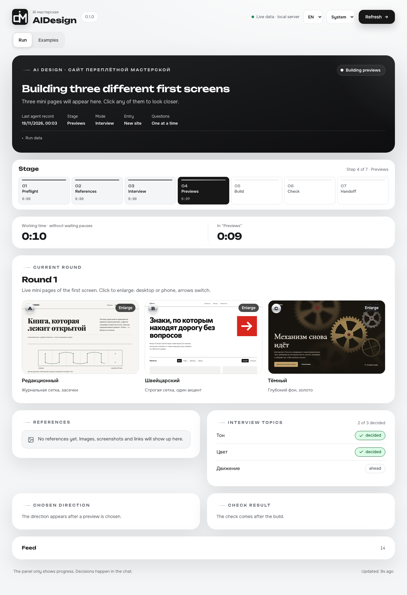
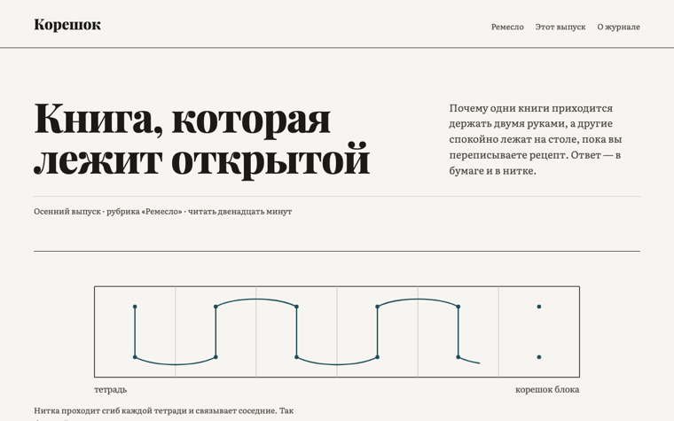
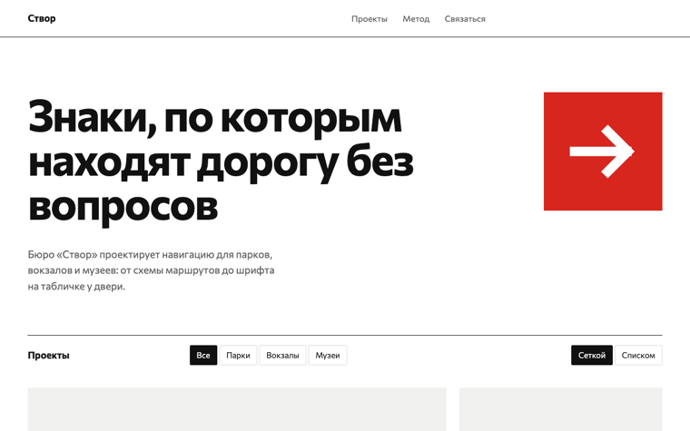
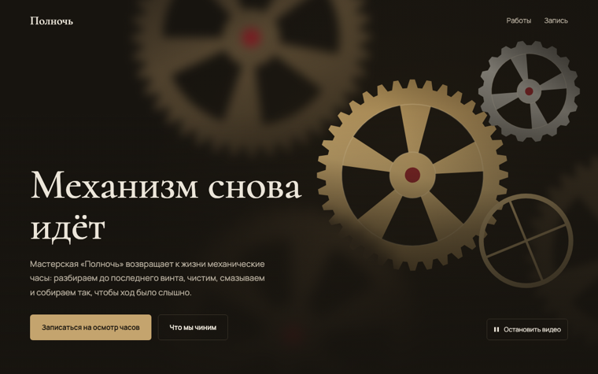
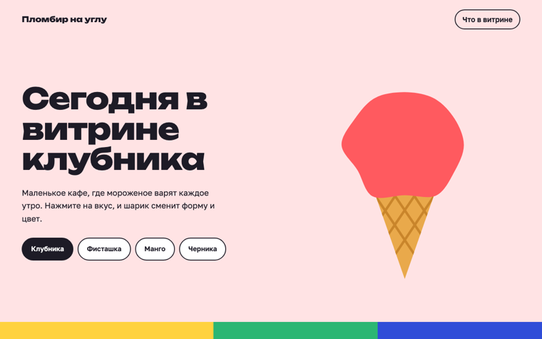

# AI Design

<p align="center"><strong>Tell the agent what site you want — and see it before it is built.</strong></p>

<p align="center"><b>English</b> · <a href="README.ru.md">Русский</a></p>

AI Design is a front-end design skill. It looks at your references, interviews you about taste, style and tone, shows **three live previews** on a panel, repeats the rounds until one feels right, and only then builds the page. At the end it leaves written design rules, so any later agent continues in the same style. The goal is a site that does not look like every other AI-made site.

It works on its own: whatever is missing on the computer it names and installs itself, after your «yes». It works on an empty folder (a new site, a landing page, a block, a web-app screen, an HTML presentation) and on a site that already exists (a redesign that does not break it). Before the first edit it makes a copy of the project, keeps the style in one folder `design-system/` that you can hand to another person, and on request shows a large site in Figma.

The family: [AISpa](https://github.com/alexfisenkov/aispa) — builds whole projects from a description · [AI Мастерская](https://github.com/alexfisenkov/aimaster) — the workshop's skill pack · [AIEditing](https://github.com/alexfisenkov/AIEditing) — video editing.

<p align="center">
  
</p>

<p align="center"><sub>The panel during a run: seven stages, the current round with three live previews you can enlarge, the history of rounds, the interview topics.</sub></p>

## What is new in 0.4.0

Four things the best open design skills can do are now in AI Design too:

- **Style from a link.** Give the address of a site you like — the agent opens it in a browser (`tools/extract.py`) and takes the colours with their roles, the typefaces and sizes, spacing, corner radii, shadows, motion, buttons and fields. You see in short what was taken. It takes principles, not the brand: the other site's logo, texts and brand typefaces stay with their owner. The agent closes the cookie window with «accept», as an ordinary visitor would; if the site asks robots to stay away (`robots.txt`), the agent stays away.
- **A reference book for your business.** 45 styles, 160 palettes with checked readability, 90 type pairs with Cyrillic, 71 industries, 24 landing-page layouts. `tools/pick.py` searches in Russian — «кофейня уютная тёплая» — and offers three different directions for the three previews. The industry is only a first guess: your interview answers come first.
- **A check on par with Impeccable.** All 62 Impeccable rules: in the code — now also in React, Vue, Svelte and Astro components and in Tailwind classes — and in the browser, `check.py --browser`: text spilling over the edge or covered by another layer, a line too long, a single word on the last line, text that never appears, a script that crashed. If you want, the check runs by itself after every edit the agent makes — only in Claude Code and only after your «yes».
- **A site as a film.** Scrolling moves the camera through 5–7 scenes. `tools/film.py` drafts the scene plan, works out the cost in your budget before any generation, makes a test frame, joins the scenes without seams, prepares the video for desktop and phone, builds the page and takes a snapshot of every join. Generation only goes through your connected generators and within the sum you named. Only if you chose it.

The browser for the first three is installed once per computer, after your «yes», into the skill's shared cache — `~/.cache/aidesign/node/` (on Windows `%LOCALAPPDATA%\aidesign\node`), not into your project (`tools/browser.py`).

---

## From scratch: nothing on the computer yet

If you have neither an agent nor Node.js yet — four steps. Everything else (Python, git, a browser for checking, ffmpeg for video) the skill finds and installs itself, asking once.

1. **The agent.** Install the Claude app and open its Code tab — [claude.com/download](https://claude.com/download) — or Codex — [developers.openai.com/codex](https://developers.openai.com/codex).
2. **Node.js LTS** (for the `npx` command). The easiest is the LTS installer from [nodejs.org](https://nodejs.org/en/download). Or one command in the Terminal:

   | System | Command |
   |---|---|
   | Mac (with Homebrew) | `brew install node` |
   | Windows | `winget install OpenJS.NodeJS.LTS` |
   | Linux | `sudo apt install nodejs npm` (Fedora — `sudo dnf install nodejs npm`) |

   You need version 22 or newer (`node --version`). On Linux the system package can be older — then install the current LTS from [nodejs.org](https://nodejs.org/en/download); the skill will also say «нужно обновить» (needs an update).

   If a password is asked, you type it into your own Terminal — never into the chat with the agent.
3. **The skill:** `npx skills add alexfisenkov/aidesign --skill aidesign -g -y -a claude-code codex` (details below, in «Installation»). Restart the agent.
4. **First run:** open the agent in the folder of the future site and type «run /aidesign» (in Codex — `$aidesign`). The skill first checks for Python and, if it is missing, gives one command for your system.

### Without Node.js

Download the archive of the latest release from the [releases](https://github.com/alexfisenkov/aidesign/releases) page, unpack it and put the `skills/aidesign` folder into the agent's skills folder:

| Agent | Where to put it |
|---|---|
| Claude Code | `~/.claude/skills/aidesign` (Windows: `%USERPROFILE%\.claude\skills\aidesign`) |
| Codex | `~/.agents/skills/aidesign` (older Codex versions — `~/.codex/skills/aidesign`) |

Restart the agent. Update the same way: a new archive over the old folder.

---

## Installation

### If you'd rather not open a terminal

Open your AI agent — Claude Code or Codex — and paste this:

```
Install the AI Design skill for me. Run in the terminal:

npx skills add alexfisenkov/aidesign --skill aidesign -g -y -a claude-code codex

If npx is not found, give me a link to download Node.js and wait.
Don't install anything else.
When you're done, tell me in one line that it's ready and that the session needs a restart.
```

The agent does the rest. Then restart it — skills are loaded at startup.

### From the terminal

```bash
npx skills add alexfisenkov/aidesign --skill aidesign -g -y -a claude-code codex
```

| Flag | What it does |
|------|--------------|
| `--skill aidesign` | Installs only AI Design |
| `-a claude-code codex` | For Claude Code and Codex (other agents — name them instead) |
| `-g` | Globally — the skill is available in every project |
| `-y` | Don't ask questions |

**Requires:** [Node.js](https://nodejs.org) (for `npx`), Python 3.9+ (the panel and the checks use only its standard library) and any supported AI agent. The rest — git, the Chromium browser through Playwright for screenshots, ffmpeg for video — the skill checks at the start of a run and installs with official commands after your «yes».

**Equipping the agent** means only programs on the computer plus Figma MCP if you want it: the browser for checking is Playwright from the command line, with no separate MCP; AI Design installs no other MCPs or skills.

**Update:** `npx skills update aidesign -g`, then restart the session. At the start of a run the skill compares its version with this repository and tells you in one line if a new one is out; it never updates in the middle of a run. To turn the check off: the environment variable `AIDESIGN_NO_UPDATE_CHECK=1`.

---

## How to use it

Open your agent in the folder of the future site and type:

```
/aidesign a landing page for a small bookbinding workshop
```

In Codex the command is `$aidesign`. A bare `/aidesign` resumes an interrupted run.

Name the mode in the command or the agent asks one question first:

| Mode | How to turn it on | What you're asked |
|---|---|---|
| **On my own from the brief** (`auto`) | `/aidesign auto ...` | Almost nothing: three previews from your description and references; you only choose |
| **Only what matters** (`important`) | `/aidesign important ...` | The 5–10 main things about taste; the rest is decided for you |
| **Interview** (`interview`) | `/aidesign interview ...` | A detailed talk, topic by topic, with the agent's own answer to every question. Say «по одному» for one question per message |

Questions that really change the look are marked ⚑ with options а/б/в — that letter you pick yourself. For the rest «ок» is enough, and «дальше решай сам» closes the interview at any moment.

### The seven stages

| Stage | What happens |
|---|---|
| **Preparation** | Is Python there and what else the computer needs (one question about installing), mode, entry (new or existing site), the panel opens by itself, the project laid out in folders |
| **References** | You show images, screenshots or links; from a link the agent takes the site's style itself (`tools/extract.py`) and writes down what you like in each |
| **Interview** | Questions about the audience, character, tone, density, colour, type, motion |
| **Previews** | Three truly different first screens, live, — the reference book for your business suggests the directions (`tools/pick.py`); you click, choose, say what to change; round after round until it feels right |
| **Build** | First a copy of the project, then the design system, then the real pages; the agent reads the knowledge it needs for your case |
| **Check** | A script catches the marks of template design (84 rules, 11 of them in the browser, `check.py --browser`), a second one catches style that bypasses the design system; screenshots on phone and desktop; found problems are fixed |
| **Handoff** | `DESIGN.md`, the design system, a block of rules in the project memory, the «after» copy; a short report; Figma if the site is large and you want it |

### The panel

At the start the agent opens a panel — a page you never have to find or launch. It shows the stage, working time, your references, the interview topics, the **current round** with three live miniatures (click one: full screen, a switch between desktop and phone, arrows between variants), the history of rounds with your feedback, the chosen direction, the check result and a feed of events. A tab **Examples** shows seven finished demo pages. Light and dark theme, Russian and English. Works offline; live previews open through a local server (a plain `file://` shows snapshots of the variants and a hint to open the `http://` address instead).

<p align="center">
  
  
  
  
</p>

<p align="center"><sub>Four of the seven demo pages that ship with the skill. They are made by the skill itself and pass its own checker.</sub></p>

### Photos, video and budget

You decide where pictures and video come from: your own, generated, a mix, or for now captioned placeholders like «hall photo 4:5». Your own — put them in a folder; the agent checks size and quality and prepares them for the site. Particles, shaders, gradients and icons the agent makes in code, for free.

If an image or video generator is connected, the agent finds it and asks for an amount **once**: «we spend up to N on pictures and video». Within that amount it generates without asking, and the panel shows a counter «spent of N». A generation that would go over is a new question. If the service won't tell the price in advance and won't take a cap, the agent does not generate blindly: it estimates by the most expensive known price or asks you first.

### Previews are real

Every preview is a working first screen with the real main technique: the video plays with the scroll, the shader draws, the effect answers the mouse. The material is your texts and pictures; generated material only if you allowed generation in previews, asked «show it with real pictures», or the main technique can't be shown without it (scroll video, the main first-screen photo) — that is material for the main technique, and it too stays within the budget. After the choice the agent does not rebuild the site from scratch — it polishes the chosen variant: adds the sections, writes the texts with you, revises round after round until you say «done».

Open previews at the `http://localhost:…` address the agent gives you, not as a file: a preview opened as a file won't load video and effects. A panel opened as a file still shows snapshots of the variants.

---

## Two ways in

- **A new site.** An empty folder, or a folder with only your notes. The agent starts from references and the interview.
- **An existing site.** The agent reads it first and by default redoes the design **inside the brand's identity**: colours, type and logo stay recognisable, nothing breaks. A completely new look only on your direct request.

Either way the run ends the same: `DESIGN.md` with the rules, and a block between `<!-- aidesign:start -->` and `<!-- aidesign:end -->` in the project memory file (`AGENTS.md` or `CLAUDE.md`). In an empty folder the skill creates `AGENTS.md` containing only that block.

---

## Backups and undo

Before the first edit of your files the skill makes a full copy of the project, and one more at the end of the run. The copies are folders in `.aidesign-work/backups/` (you can see them in Finder or Explorer) with a list of files and checksums; each is verified by reading it back. Under git there is also a branch or a commit, your choice.

Say «put it back as it was» — the agent shows the list of copies and restores any of them: it first saves the current state, and files that were not in the copy are not deleted but moved to a separate folder. The undo itself is `python3 .aidesign-work/backup.py restore --root . --id <copy> --yes`. Copies are never deleted without your word; a copy over 500 MB first asks you, naming the size.

---

## Design system

The project's style lives in one folder, `design-system/`: `tokens.css` — colours, fonts, spacing, radii, shadows and motion as CSS variables (the source), `tokens.json` — the same for other programs and Figma (derived from `tokens.css`), `styleguide.html` — a showcase of buttons, cards, forms and sections in your style, `README.md` — how to plug it in, `CHANGELOG.md` — what changed and why. The site takes its style only from there, and a check catches «a colour that bypasses the tokens». On an existing site the skill first writes what is already there into `design-system/` «as it was», and only then changes it. Say «pack the design system» — you get an archive you can give to a person or another agent.

---

## Figma if you want it

Figma is optional. If the site has 4 pages or more, the skill offers in one line at the end to show it in Figma; say no and it won't ask again. The connection is the official Figma MCP (`https://mcp.figma.com/mcp`); you sign in yourself in the browser:

- Claude Code — `claude mcp add --transport http figma https://mcp.figma.com/mcp` (or the plugin `figma@claude-plugins-official`);
- Codex — `codex mcp add figma --url https://mcp.figma.com/mcp`, then `codex mcp login figma`.

With a free account all pages land as frames side by side — desktop (1280) and phone (390). With a paid Figma plan and the right to edit the file the skill lays out the file itself: a cover, a page per section, a site map with arrows between pages, the design system from `tokens.json`. The code stays the source of truth: Figma holds pictures of the pages, without animation or effects. The free Figma plan allows very little reading, so the skill only puts pages there and edits the site through the code.

---

## Together with AISpa

[AISpa](https://github.com/alexfisenkov/aispa) is the sister skill that builds whole projects from a description. They work separately; together there are two orders:

- **Design first, then build.** Run `/aidesign`, choose the look, then `/aispa`. AISpa already reads `AGENTS.md`, `CONTEXT.md` and `docs/adr/`, so the build continues in the same style with nothing to adjust.
- **Build first, then polish.** Run `/aispa`. From version 1.0.3 AISpa, when its build produced a visible page and the project has no `DESIGN.md` from AI Design (the `aidesign:` key in its front matter), ends the report with one line: run `/aidesign`. It only says so; it never starts AI Design itself.

One thing to know: AISpa treats an existing `AGENTS.md` as the user's file — it does not write into it and offers additions at the end. So if AI Design created `AGENTS.md` in an empty folder, AISpa will offer its additions instead of writing them.

---

## What's built in

- `knowledge/` — the knowledge base the agent reads by route (an index points from your answers to the files): visual language (anti-patterns, type, colour, grid and rhythm, 17 style families, how to combine, how to settle disputes between sources, about 130 audit rules, the DESIGN.md format, extracting a style from a site), the reference book (styles, palettes, type pairs, industries, landing layouts — data for `tools/pick.py`) and motion and media (motion, scroll scenes, morphing, cursor, WebGL, photo, video, an existing site, previews, surfaces) and website media (generators and budget, image and video prompts, camera and light language, photo checks, references, vector, 3D and sound, particles, shaders and icons in code, where to find AIMaster, «a site as a film»).
- `phases/` and `prompts/` — the rules of each stage and the briefs for the sub-agents that make previews, build and criticise.
- `knowledge/инструменты.md` and `knowledge/структура-проекта.md` — ready commands for screenshots, video, photos and Lighthouse, and the folder layout of a project; `knowledge/sources.json` — the registry of knowledge sources.
- `tools/ad.py` — run bookkeeping, the panel and its local server; `tools/check.py` — the template-design checker: `python3 .aidesign-work/check.py <site folder>`; `tools/setup.py` — what is installed on the computer and how to add what's missing; `tools/backup.py` — copies and undo; `tools/scaffold.py` — the project layout; `tools/designsystem.py` — tokens, the «bypassing the tokens» check, the design-system archive; `tools/media.py` — generators: what is connected, how to connect one, download and prepare photos and video for the site, the media inventory; `tools/shots.py` — 1280 and 390 snapshots of previews for the panel; `tools/rules.py` — the `aidesign` rules block in the project memory; `tools/browser.py` — the browser module (installed once per computer); `tools/extract.py` — the style of a site from a link; `tools/pick.py` — picking from the reference book; `tools/film.py` — «a site as a film»; `assets/scroll-film.js` — the engine of the film page.
- `examples/` — seven demo pages.

It's all plain markdown, HTML and Python standard library: [skills/aidesign/SKILL.md](skills/aidesign/SKILL.md).

Tests: `python3 -B -m unittest discover -s tests`. CI runs only by hand (`workflow_dispatch`) on Linux, macOS and Windows.

---

## What AI Design is built from

AI Design is a gathering of what open design skills already know, checked against each other and cut into one process. Nothing here is hidden: for every source — what exactly was taken, in what form, under which license. **Idea** — we took the thought and wrote it in our own words. **Text** — a passage was translated or retold close to the original; such files carry a header «Источник … Изменено …». **Code** — nothing was copied: the panel, the checker, style from a link, the reference book and the film engine are written from scratch, some of it after the sources (this is marked in the file header). The full text with copyright lines and the license texts is in [THIRD_PARTY_NOTICES.md](THIRD_PARTY_NOTICES.md). The same list for programs — `skills/aidesign/knowledge/sources.json`; how to add a newly found skill — [docs/пополнение.md](docs/пополнение.md).

| Source | What we took | How | License |
|---|---|---|---|
| [Impeccable](https://github.com/pbakaus/impeccable) (Paul Bakaus) | The catalogue of template-design marks, the «quality floor», rules for type, colour, layout and motion, visitor modes, the DESIGN.md format, token extraction; all 62 check rules and 14 «bad/good» samples for the tests | Text, retold and translated; the checker rewritten after it; the samples marked «modified» | Apache-2.0 |
| [frontend-design](https://github.com/anthropics/skills/tree/main/skills/frontend-design) (Anthropic) | The list of AI-design clichés, «be bold in one place», the plan of 4–6 colours and 1–2 typefaces, interface text rules | Text, retold | Apache-2.0 |
| [Taste Skill](https://github.com/Leonxlnx/taste-skill) (Leonxlnx) | Which effects fit which kind of business, the marks of AI-written copy, the «never» list, a check-list, eleven hero layouts | Text, retold; photos and code not taken | MIT |
| [UI UX Pro Max](https://github.com/nextlevelbuilder/ui-ux-pro-max-skill) (Next Level Builder) | Signs of 17 style families, UX and WCAG 2.2 rules, type pair characters, ten landing layouts, seven chart types; the design of the reference book — data, picking by industry, a contrast guard, the dark theme | Text, retold; the reference book as an idea, its content is ours; the premium version and whole data tables not taken | MIT |
| [Google Fonts](https://github.com/google/fonts) | Facts about typefaces with Cyrillic: category, styles, axes, license | Data; the fonts themselves are loaded by a Google Fonts link | Each font has its own: OFL, Apache-2.0 or UFL |
| [web-design-guidelines](https://github.com/vercel-labs/agent-skills) (Vercel) | Only the idea of auditing against a fresh rule set and reporting `file:line` | Idea | MIT (stated in the README) |
| [Web Interface Guidelines](https://github.com/vercel-labs/web-interface-guidelines) (Vercel Labs) | The interface rule set: accessibility, focus, forms, animation, type, images, performance, touch, dark theme | Text, translated and adapted to Russian typography | MIT |
| [GSAP skills](https://github.com/greensock/gsap-skills) (GreenSock) | Rules for animation, ScrollTrigger, plugins and performance | Text, retold | MIT |
| [GSAP library](https://gsap.com/licensing/) | Nothing; pages that need it load it from a CDN | None | Proprietary, free to use |
| [MengTo Skills](https://github.com/MengTo/Skills) (Meng To) | Three drawing modes for scroll stories, «never hijack the wheel», a layout of 5–7 scenes, cursor-effect rules | Text, retold | MIT |
| [shaders](https://shaders.com/license) | Nothing from presets; the cursor-trail idea is described in our own words | Idea | Package MIT; presets proprietary |
| [premium-frontend-ui](https://github.com/github/awesome-copilot/tree/main/skills/premium-frontend-ui) (GitHub, author Utkarsh Patrikar) | Directions, preloader, hiding menu, magnetic buttons, custom cursor, parallax as positions in disputes; turning cursor effects off on touch | Text, retold | MIT |
| [HyperFrames](https://github.com/heygen-com/hyperframes) (HeyGen) | Ideas for media handling and video from HTML | Idea; the block catalogue not taken | Apache-2.0 |
| [hoodini/ai-agents-skills](https://github.com/hoodini/ai-agents-skills) | Ideas only: frame budget for scroll video, text scenes | Idea; no text copied (no license file) | MIT stated in the README |
| [awesome-design-md](https://github.com/VoltAgent/awesome-design-md) (VoltAgent) | The nine-section structure of DESIGN.md | Text, retold; brand files not taken | MIT |
| [getdesign.md](https://getdesign.md/terms) | Nothing; the `npx getdesign` command is named as a path you take yourself | None | Site terms |
| [Dembrandt](https://github.com/dembrandt/dembrandt) | What to take from a site's style; how to tell colour roles and close the cookie window — for `tools/extract.py` | Text, retold; the code rewritten after it | MIT |
| [Dembrandt skills](https://github.com/dembrandt/dembrandt-skills) | Modular type scale, algorithmic palette, extracting and reproducing a site | Text, retold | MIT |
| [scroll-world](https://github.com/oso95/scroll-world) | Art-direction interview, cost estimate before generation, seamless scene joins, a separate vertical chain for phones; the «site as a film» pipeline and prompt templates for scenes and joins | Text, retold; the page engine `assets/scroll-film.js` and `tools/film.py` rewritten after it | MIT |
| [AIMaster](https://github.com/alexfisenkov/aimaster) (ours, the family) | The author's prompt guides for images and video — Nano Banana, Midjourney, GPT Image, Seedream, Seedance, Kling, Veo, camera and light language, checking photos for an artificial look, references — condensed for website media | Text, retold in our own words | MIT for the retelling, by the author's permission; AIMaster itself — the author's terms |

The process itself — the interview with ⚑ and «ок», the panel, run bookkeeping — comes from our own [AISpa](https://github.com/alexfisenkov/aispa). Names of companies and brands in the knowledge files are used only to name a style or a source; AI Design is not affiliated with them.

### Parity: what AI Design can do from the 14 sources

For every source — its mechanisms: what we **have**, what we have **partly** and what we **don't** — and why. The detailed version for the agent is `skills/aidesign/knowledge/INDEX.md`, section «Паритет».

| Source | Has | Partly | No — why |
|---|---|---|---|
| Impeccable | checks for all 62 rules without AI — in the code and in the browser; a check after every edit (after your «yes»); rules for type, colour, layout, motion; `DESIGN.md` as memory | variants right inside the running site — we have three live previews on the panel and rounds of refinement | iOS and Android versions — the skill is about the web; a start with no questions about taste — on purpose: we interview about taste |
| Taste Skill | a style for the business — the reference book and `tools/pick.py` (by rules, three different candidates); 11 first-screen layouts; marks of AI-written copy; 3D and WebGL only where they fit | the browser check at two widths (1280 and 390), not five; the after-edit check advises rather than blocks | the example photos — their license requires sharing on the same terms; generation through its own skill — we use your generators and budget |
| frontend-design | one direction, 4–6 colours and 1–2 typefaces, one bold moment, the cliché list, self-review by a separate critic | — | — |
| UI UX Pro Max | the reference book: styles, palettes with a contrast guard, type pairs, industries, landing layouts; search without the internet; about 130 quality rules | charts — 7 kinds out of 25 (the skill is about sites); tokens — our own `tokens.json` format, not DTCG | separate rules for each page — on purpose one `DESIGN.md`; right-to-left writing — out of scope; the premium version — its terms are not public |
| web-design-guidelines and Web Interface Guidelines | about 130 audit rules: accessibility, focus, forms, fine typography; findings as `file:line` | — | fresh rules from the internet before every check — on purpose: the skill works offline |
| GSAP skills | animation, scroll scenes, SVG morphing, splitting text, performance | — | the code of the GSAP library itself — its license; pages load it from a CDN |
| add-shader-cursor-trail | when to switch a cursor effect off: touch, «reduce motion», high contrast | a cursor trail — in our own words and shader recipes | the effect graph itself — its terms are not confirmed |
| scroll-world-storytelling | three story modes without mixing; the mouse wheel is never hijacked; 5–7 scenes; the builder and the checker are different agents | the check at two widths plus snapshots of the joins, not four widths | — |
| premium-frontend-ui | preloader, hiding menu, magnetic buttons, custom cursor, parallax — when you ask | directions — as style families | scroll hijacking — on purpose: we never hijack the mouse wheel |
| HyperFrames | treating photos with one look; HTML presentations | — | video from HTML, hundreds of ready blocks, converters — out of scope (that is video, not a site), the blocks have mixed licenses |
| hoodini: video-to-landing-page, parallax-landing-page | a clip → frames → scroll through the frames within a weight budget | — | wheel hijacking and all-caps eyebrows — on purpose, these are marks of a template; the text — the repository has no license file |
| awesome-design-md and getdesign.md | the `DESIGN.md` format; a showcase of the design system in your style | — | ready breakdowns of other brands — someone else's identity; you take a brand breakdown yourself (`npx getdesign`) |
| dembrandt and dembrandt-skills | the style of a site from a link — `tools/extract.py`: colours with roles, typefaces, spacing, shapes, motion, buttons and fields, dark theme, phone, the cookie window; type scale, palette, density, accessibility | the result is a `tokens.css` in our format and a report, not DTCG | several pages at once and comparing with an earlier snapshot — the next step |
| scroll-world | an interview about scenes and budget; a cost estimate and a test frame before generation; seamless scene joins; a separate phone version; snapshots of the joins — `tools/film.py` | scene generation — through your connected generators, not through its own service keys | — |

---

## License

[MIT](LICENSE) © Alexander Fisenkov, © Nick Vels (Autopilot 2.2.0, the base) — you may use, modify and distribute it, including in commercial projects.
