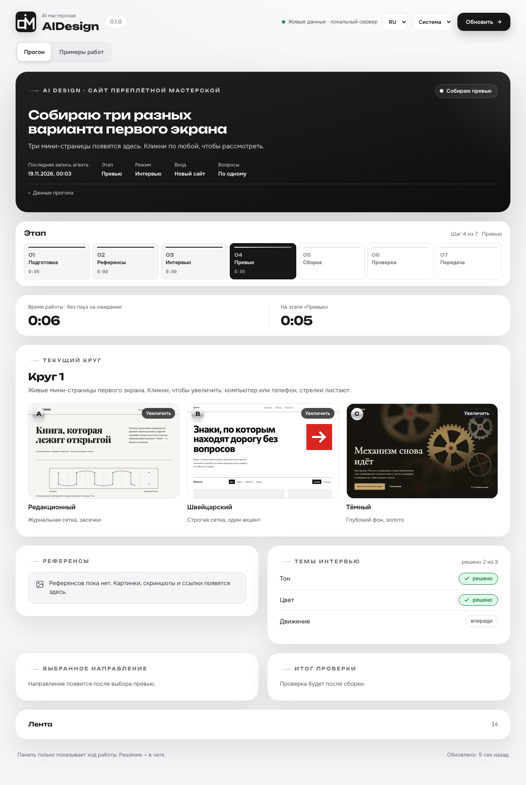
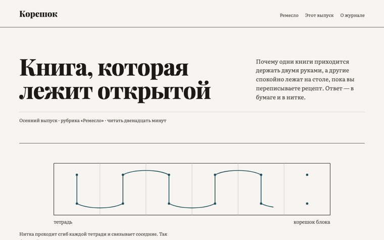
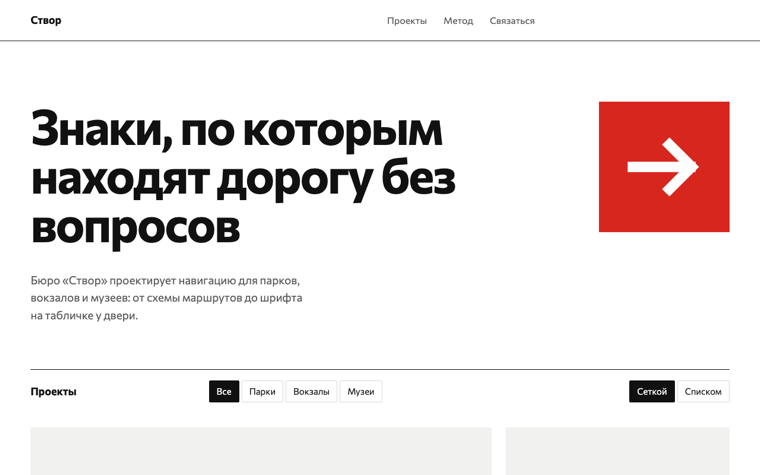
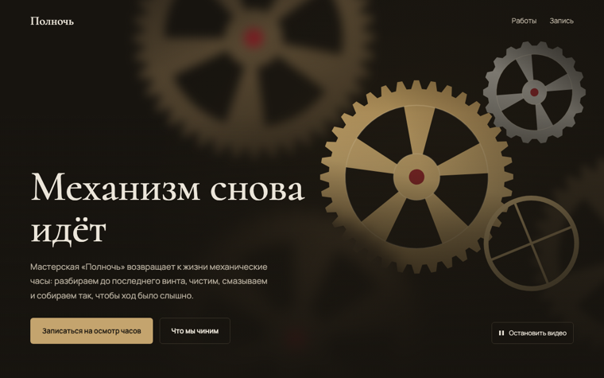
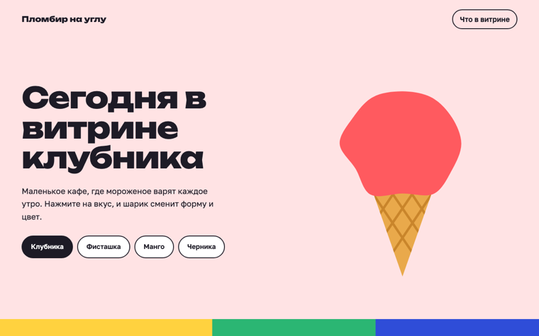

# AI Design

<p align="center"><strong>Расскажите агенту, какой нужен сайт, — и увидьте его до того, как он собран.</strong></p>

<p align="center"><a href="README.md">English</a> · <b>Русский</b></p>

AI Design — скилл фронтенд-дизайна. Он смотрит ваши референсы, расспрашивает о вкусе, стиле и тоне, показывает **три живых превью** на панели, повторяет круги, пока одно не понравится, и только потом собирает страницу. В конце оставляет записанные правила дизайна, чтобы любой следующий агент продолжил в том же стиле. Цель — сайт, который не похож на все остальные сайты, сделанные ИИ.

Он работает сам по себе: чего не хватает на компьютере, он скажет и поставит сам, с вашего «да». Работает в пустой папке (новый сайт, лендинг, блок, экран веб-приложения, HTML-презентация) и на готовом сайте (редизайн, который ничего не ломает). Перед первой правкой делает копию проекта, стиль держит в одной папке `design-system/`, которую можно отдать другому человеку, а большой сайт по желанию показывает в Figma.

Семейство: [AISpa](https://github.com/alexfisenkov/aispa) — собирает проекты целиком по описанию · [AI Мастерская](https://github.com/alexfisenkov/aimaster) — набор скиллов мастерской · [AIEditing](https://github.com/alexfisenkov/AIEditing) — монтаж видео.

<p align="center">
  
</p>

<p align="center"><sub>Панель во время прогона: семь этапов, текущий круг с тремя живыми превью, которые можно увеличить, история кругов, темы интервью.</sub></p>

## Что нового в 0.4.0

Четыре вещи, которые умеют лучшие открытые дизайн-скиллы, теперь есть и в AI Design:

- **Стиль по ссылке.** Дайте адрес сайта, который нравится, — агент откроет его в браузере (`tools/extract.py`) и снимет цвета с ролями, шрифты и размеры, отступы, скругления, тени, движение, кнопки и поля. Вы коротко видите, что взято. Берутся принципы, а не бренд: логотип, тексты и фирменные шрифты чужого сайта остаются у владельца. Окно cookies агент закрывает кнопкой «принять», как обычный посетитель; если сайт просит роботов не заходить (`robots.txt`), агент не заходит.
- **Справочник под ваше дело.** 45 стилей, 160 палитр с проверенной читаемостью, 90 пар шрифтов с кириллицей, 71 отрасль, 24 схемы лендингов. `tools/pick.py` ищет по-русски — «кофейня уютная тёплая» — и предлагает три разных направления для трёх превью. Отрасль — только первая догадка: ваши ответы в интервью главнее.
- **Проверка как у Impeccable.** Все 62 правила Impeccable: по коду — теперь и в компонентах React, Vue, Svelte, Astro и в классах Tailwind — и в браузере, `check.py --browser`: текст вылез за край или закрыт другим слоем, строка слишком длинная, одно слово в последней строке, текст так и не появился, скрипт упал. По желанию проверка идёт сама после каждой правки агента — только в Claude Code и только с вашего «да».
- **Сайт как фильм.** Прокрутка ведёт камеру через 5–7 сцен. `tools/film.py` составит план сцен, посчитает смету в вашем бюджете до генерации, сделает пробный кадр, сошьёт сцены без швов, подготовит видео для компьютера и телефона, соберёт страницу и снимет каждый стык. Генерация — только через ваши подключённые генераторы и в пределах названной суммы. Только если вы его выбрали.

Браузер для первых трёх ставится один раз на компьютер, с вашего «да», в общий кэш скилла — `~/.cache/aidesign/node/` (в Windows `%LOCALAPPDATA%\aidesign\node`), а не в ваш проект (`tools/browser.py`).

---

## С нуля: на компьютере ничего нет

Если у вас ещё нет ни агента, ни Node.js, — четыре шага. Дальше всё недостающее (Python, git, браузер для проверки, ffmpeg для видео) скилл найдёт и поставит сам, спросив один раз.

1. **Агент.** Поставьте приложение Claude и откройте в нём вкладку Code — [claude.com/download](https://claude.com/download), — или Codex — [developers.openai.com/codex](https://developers.openai.com/codex).
2. **Node.js LTS** (для команды `npx`). Проще всего — установщик LTS с [nodejs.org](https://nodejs.org/en/download). Или одной командой в Терминале:

   | Система | Команда |
   |---|---|
   | Mac (с Homebrew) | `brew install node` |
   | Windows | `winget install OpenJS.NodeJS.LTS` |
   | Linux | `sudo apt install nodejs npm` (Fedora — `sudo dnf install nodejs npm`) |

   Нужна версия 22 или новее (`node --version`). В Linux пакет системы бывает старше — тогда поставьте свежую LTS с [nodejs.org](https://nodejs.org/en/download); скилл тоже скажет «нужно обновить».

   Пароль, если его спросят, вы вводите в своём Терминале — агенту в чат его не пишут никогда.
3. **Скилл:** `npx skills add alexfisenkov/aidesign --skill aidesign -g -y -a claude-code codex` (подробно — ниже, в «Установке»). Перезапустите агента.
4. **Первый запуск:** откройте агента в папке будущего сайта и напишите «запусти /aidesign» (в Codex — `$aidesign`). Скилл первым делом проверит, есть ли Python, и если нет — даст одну команду под вашу систему.

### Без Node.js

Скачайте архив последнего выпуска со страницы [releases](https://github.com/alexfisenkov/aidesign/releases), распакуйте и положите папку `skills/aidesign` в папку скиллов агента:

| Агент | Куда положить |
|---|---|
| Claude Code | `~/.claude/skills/aidesign` (Windows: `%USERPROFILE%\.claude\skills\aidesign`) |
| Codex | `~/.agents/skills/aidesign` (старые версии Codex — `~/.codex/skills/aidesign`) |

Перезапустите агента. Обновлять так же: новый архив поверх старой папки.

---

## Установка

### Не хотите открывать терминал

Откройте вашего ИИ-агента — Claude Code или Codex — и вставьте:

```
Установи мне скилл AI Design. Выполни в терминале:

npx skills add alexfisenkov/aidesign --skill aidesign -g -y -a claude-code codex

Если npx не найден, дай ссылку на скачивание Node.js и подожди.
Больше ничего не устанавливай.
Когда закончишь, напиши одной строкой, что готово и что сессию нужно перезапустить.
```

Остальное агент сделает сам. Потом перезапустите его — скиллы загружаются при старте.

### Через терминал

```bash
npx skills add alexfisenkov/aidesign --skill aidesign -g -y -a claude-code codex
```

| Флаг | Что делает |
|------|------------|
| `--skill aidesign` | Ставит только AI Design |
| `-a claude-code codex` | Для Claude Code и Codex (другие агенты — назовите их вместо этих) |
| `-g` | Глобально — скилл доступен в каждом проекте |
| `-y` | Без вопросов |

**Нужно:** [Node.js](https://nodejs.org) (для `npx`), Python 3.9+ (панель и проверки используют только его стандартную библиотеку) и любой поддерживаемый ИИ-агент. Остальное — git, браузер Chromium через Playwright для снимков, ffmpeg для видео — скилл проверит в начале прогона и поставит официальными командами после вашего «да».

**Оснащение агента** — только программы на компьютере и Figma MCP по желанию: браузер для проверки — Playwright из командной строки, без отдельного MCP; другие MCP и скиллы AI Design не ставит.

**Обновление:** `npx skills update aidesign -g`, затем перезапустите сессию. В начале прогона скилл сверяет свою версию с этим репозиторием и одной строкой сообщает, если вышла новая; посреди прогона он не обновляется. Выключить проверку: переменная окружения `AIDESIGN_NO_UPDATE_CHECK=1`.

---

## Как пользоваться

Откройте агента в папке будущего сайта и напишите:

```
/aidesign лендинг для небольшой переплётной мастерской
```

В Codex команда — `$aidesign`. Голый `/aidesign` продолжает прерванный прогон.

Режим можно назвать в команде, иначе агент сначала задаст один вопрос:

| Режим | Как включить | О чём спросят |
|---|---|---|
| **Сам по брифу** (`auto`) | `/aidesign auto ...` | Почти ни о чём: три превью по вашему описанию и референсам, вы только выбираете |
| **Только важное** (`important`) | `/aidesign important ...` | 5–10 главных вещей о вкусе, остальное решит сам |
| **Интервью** (`interview`) | `/aidesign interview ...` | Подробный разговор тема за темой, к каждому вопросу — собственный ответ агента. Скажите «по одному» — вопросы придут по одному |

Вопросы, от которых правда зависит облик, помечены ⚑ с вариантами а/б/в — эту букву вы выбираете сами. На остальные хватит «ок», а «дальше решай сам» закрывает интервью в любой момент.

### Семь этапов

| Этап | Что происходит |
|---|---|
| **Подготовка** | Есть ли Python и что ещё нужно на компьютере (один вопрос об установке), режим, вход (новый или готовый сайт), панель открывается сама, раскладка проекта по папкам |
| **Референсы** | Вы показываете картинки, скриншоты или ссылки; со ссылки агент сам снимает стиль сайта (`tools/extract.py`) и записывает, что нравится в каждом |
| **Интервью** | Вопросы об аудитории, характере, тоне, плотности, цвете, шрифте, движении |
| **Превью** | Три по-настоящему разных первых экрана, живые, — направления подсказывает справочник под ваше дело (`tools/pick.py`); вы кликаете, выбираете, говорите, что поменять; круг за кругом, пока не понравится |
| **Сборка** | Сначала копия проекта, затем дизайн-система, затем настоящие страницы; агент читает нужные именно вам знания |
| **Проверка** | Скрипт ловит приметы шаблонного дизайна (84 правила, из них 11 — в браузере, `check.py --browser`), второй — стиль мимо дизайн-системы; снимки на телефоне и компьютере; найденное исправляется |
| **Передача** | `DESIGN.md`, дизайн-система, блок правил в памяти проекта, копия «после»; короткий отчёт; Figma — если сайт большой и вы хотите |

### Панель

В начале агент открывает панель — страницу, которую не нужно искать и запускать. Она показывает этап, время работы, ваши референсы, темы интервью, **текущий круг** с тремя живыми миниатюрами (клик по любой — на весь экран, переключатель «компьютер / телефон», стрелки между вариантами), историю кругов с вашими отзывами, выбранное направление, итог проверки и ленту событий. Вкладка **Примеры работ** показывает семь готовых демо-страниц. Светлая и тёмная темы, русский и английский. Работает без интернета; живые превью открываются через локальный сервер (при обычном `file://` панель покажет снимки вариантов и подскажет открыть адрес `http://`).

<p align="center">
  
  
  
  
</p>

<p align="center"><sub>Четыре из семи демо-страниц, которые идут со скиллом. Их сделал сам скилл, и они проходят его же проверку.</sub></p>

### Фото, видео и бюджет

Откуда возьмутся картинки и видео, решаете вы: свои, сгенерированные, вперемешку или пока подписанные плашки «фото зала 4:5». Свои — положите в папку, агент сам проверит размер и качество и подготовит под сайт. Частицы, шейдеры, градиенты и иконки агент делает кодом, бесплатно.

Если подключён генератор картинок или видео, агент находит его сам и спрашивает сумму **один раз**: «на картинки и видео тратим до N». Дальше он генерирует без вопросов в пределах этой суммы, а на панели виден счётчик «потрачено из N». Генерация, которая выйдет за сумму, — новый вопрос. Цену заранее не знает и сервис не даёт поставить потолок — агент не генерирует наугад: прикидывает по самой дорогой известной цене или сначала спрашивает вас.

### Превью настоящие

Каждое превью — рабочий первый экран с настоящим главным приёмом: видео крутится от прокрутки, шейдер рисует, эффект отзывается на мышь. Материал — ваши тексты и картинки; сгенерированное — только если вы разрешили генерацию в превью, попросили «покажи с настоящими картинками» или без него не показать главный приём (видео по прокрутке, главное фото первого экрана) — это материал главного приёма, и он тоже идёт в пределах бюджета. После выбора агент не собирает сайт заново, а доводит выбранный вариант: достраивает разделы, дописывает тексты с вами, правит по кругу, пока вы не скажете «готово».

Смотрите превью по адресу `http://localhost:…`, который назовёт агент, а не как файл: открытое как файл превью не загрузит видео и эффекты. Панель, открытая как файл, покажет хотя бы снимки вариантов.

---

## Два входа

- **Новый сайт.** Пустая папка или папка только с вашими заметками. Агент начинает с референсов и интервью.
- **Готовый сайт.** Агент сначала читает его и по умолчанию переделывает дизайн **внутри идентичности бренда**: цвета, шрифт и логотип остаются узнаваемыми, ничего не ломается. Совсем новый облик — только по вашей прямой просьбе.

В обоих случаях прогон кончается одним и тем же: `DESIGN.md` с правилами и блок между `<!-- aidesign:start -->` и `<!-- aidesign:end -->` в файле памяти проекта (`AGENTS.md` или `CLAUDE.md`). В пустой папке скилл создаёт `AGENTS.md` только с этим блоком.

---

## Бэкапы и откат

Перед первой правкой ваших файлов скилл делает полную копию проекта, а в конце прогона — ещё одну. Копии лежат папками в `.aidesign-work/backups/` (их видно в Finder или Проводнике) со списком файлов и контрольными суммами; каждая проверяется обратным чтением. Под git — вдобавок ветка или коммит, на выбор.

Скажите «верни как было» — агент покажет список копий и вернёт любую: сначала сохранит текущее состояние, файлы, которых в копии не было, не удалит, а унесёт в отдельную папку. Сам откат — `python3 .aidesign-work/backup.py restore --root . --id <копия> --yes`. Копии не удаляются без вашего слова; копия больше 500 МБ — сначала вопрос с размером.

---

## Дизайн-система

Стиль проекта живёт в одной папке `design-system/`: `tokens.css` — цвета, шрифты, отступы, радиусы, тени и движение переменными CSS (источник), `tokens.json` — то же для других программ и Figma (выводится из `tokens.css`), `styleguide.html` — витрина кнопок, карточек, форм и разделов в вашем стиле, `README.md` — как подключить, `CHANGELOG.md` — что менялось и почему. Сайт берёт стиль только оттуда, а проверка ловит «цвет мимо токенов». На готовом сайте скилл сначала записывает в `design-system/` то, что уже есть, «как было», и только потом меняет. Скажите «упакуй дизайн-систему» — получите архив, который можно отдать человеку или другому агенту.

---

## Figma по желанию

Figma не обязательна. Если в сайте 4 и больше страниц, скилл в конце одной строкой предложит показать его в Figma; откажетесь — больше не спросит. Подключение — официальный Figma MCP (`https://mcp.figma.com/mcp`), вход вы делаете сами в браузере:

- Claude Code — `claude mcp add --transport http figma https://mcp.figma.com/mcp` (или плагин `figma@claude-plugins-official`);
- Codex — `codex mcp add figma --url https://mcp.figma.com/mcp`, затем `codex mcp login figma`.

С бесплатным аккаунтом все страницы ложатся кадрами рядом — компьютер (1280) и телефон (390). С платным планом Figma и правом редактировать файл скилл сам раскладывает файл: обложка, страница на раздел, карта сайта со стрелками переходов, дизайн-система из `tokens.json`. Код остаётся главным: в Figma — картинки страниц, без анимации и эффектов. Бесплатный тариф Figma мало разрешает читать, поэтому скилл туда только кладёт страницы, а правит сайт по коду.

---

## Вместе с AISpa

[AISpa](https://github.com/alexfisenkov/aispa) — скилл-сосед, который собирает проекты целиком по описанию. Они работают порознь; вместе — два порядка:

- **Сначала дизайн, потом сборка.** Запустите `/aidesign`, выберите облик, затем `/aispa`. AISpa и так читает `AGENTS.md`, `CONTEXT.md` и `docs/adr/`, поэтому сборка продолжает в том же стиле, ничего не правя.
- **Сначала сборка, потом доводка.** Запустите `/aispa`. С версии 1.0.3 AISpa, если сборка дала видимую страницу, а в проекте нет `DESIGN.md` от AI Design (ключ `aidesign:` во фронтматтере), кончает отчёт одной строкой: запустите `/aidesign`. Она только подсказывает и сама AI Design не запускает.

Одно, что стоит знать: AISpa считает готовый `AGENTS.md` файлом пользователя — не пишет в него, а в конце предлагает дополнения. Поэтому если AI Design создал `AGENTS.md` в пустой папке, AISpa предложит свои дополнения, а не запишет их.

---

## Что внутри

- `knowledge/` — база знаний, которую агент читает по маршруту (индекс ведёт от ваших ответов к файлам): визуальный язык (антипаттерны, шрифт, цвет, сетка и ритм, 17 семейств стилей, как сочетать, как решать споры между источниками, около 130 правил аудита, формат DESIGN.md, как извлечь стиль с сайта), справочник (стили, палитры, пары шрифтов, отрасли, схемы лендингов — данные для `tools/pick.py`) и движение с медиа (движение, сцены при прокрутке, морфинг, курсор, WebGL, фото, видео, готовый сайт, превью, поверхности) и медиа для сайта (генераторы и бюджет, промпты картинок и видео, язык камеры и света, проверка фото, референсы, вектор, 3D и звук, частицы, шейдеры и иконки кодом, где найти AIMaster, «сайт как фильм»).
- `phases/` и `prompts/` — правила каждого этапа и задания субагентам, которые делают превью, собирают и критикуют.
- `knowledge/инструменты.md` и `knowledge/структура-проекта.md` — готовые команды снимков, видео, фото и Lighthouse и схема папок проекта; `knowledge/sources.json` — реестр источников знаний.
- `tools/ad.py` — учёт прогона, панель и её локальный сервер; `tools/check.py` — проверка шаблонности: `python3 .aidesign-work/check.py <папка сайта>`; `tools/setup.py` — что стоит на компьютере и как поставить недостающее; `tools/backup.py` — копии и откат; `tools/scaffold.py` — раскладка проекта; `tools/designsystem.py` — токены, проверка «мимо токенов», архив дизайн-системы; `tools/media.py` — генераторы: что подключено, как подключить, скачать и подготовить фото и видео под сайт, опись медиа; `tools/shots.py` — снимки превью 1280 и 390 для панели; `tools/rules.py` — блок правил `aidesign` в памяти проекта; `tools/browser.py` — браузерный модуль (ставится один раз на компьютер); `tools/extract.py` — стиль сайта по ссылке; `tools/pick.py` — подбор из справочника; `tools/film.py` — «сайт как фильм»; `assets/scroll-film.js` — движок страницы-фильма.
- `examples/` — семь демо-страниц.

Всё это обычный markdown, HTML и стандартная библиотека Python: [skills/aidesign/SKILL.md](skills/aidesign/SKILL.md).

Тесты: `python3 -B -m unittest discover -s tests`. CI запускается только вручную (`workflow_dispatch`) на Linux, macOS и Windows.

---

## Из чего собран AI Design

AI Design — это собранное вместе то, что уже знают открытые дизайн-скиллы: сверено друг с другом и сложено в один процесс. Ничего не скрыто: по каждому источнику — что именно взято, в каком виде, под какой лицензией. **Идея** — взяли мысль и написали своими словами. **Текст** — отрывок переведён или пересказан близко к оригиналу; такие файлы начинаются с шапки «Источник … Изменено …». **Код** — не копировался ничего: панель, проверка, стиль по ссылке, справочник и движок фильма написаны с нуля, часть — по мотивам источников (это помечено в шапке файла). Полный текст со строками копирайта и тексты лицензий — в [THIRD_PARTY_NOTICES.md](THIRD_PARTY_NOTICES.md). Тот же список для программ — `skills/aidesign/knowledge/sources.json`; как добавить новый найденный скилл — [docs/пополнение.md](docs/пополнение.md).

| Источник | Что взято | В каком виде | Лицензия |
|---|---|---|---|
| [Impeccable](https://github.com/pbakaus/impeccable) (Paul Bakaus) | Каталог примет шаблонного дизайна, «пол качества», правила шрифта, цвета, раскладки и движения, режимы посетителя, формат DESIGN.md, извлечение токенов; все 62 правила проверки и 14 образцов «плохо/хорошо» для тестов | Текст, пересказ и перевод; проверка написана заново по мотивам; образцы — с пометкой «изменено» | Apache-2.0 |
| [frontend-design](https://github.com/anthropics/skills/tree/main/skills/frontend-design) (Anthropic) | Список клише ИИ-дизайна, «смелость в одном месте», план «4–6 цветов и 1–2 гарнитуры», правила текста интерфейса | Текст, пересказ | Apache-2.0 |
| [Taste Skill](https://github.com/Leonxlnx/taste-skill) (Leonxlnx) | Какие эффекты подходят какому делу, приметы ИИ-текста, список «никогда», чек-лист, одиннадцать раскладок героя | Текст, пересказ; фото и код не брались | MIT |
| [UI UX Pro Max](https://github.com/nextlevelbuilder/ui-ux-pro-max-skill) (Next Level Builder) | Признаки 17 семейств стилей, UX-правила и WCAG 2.2, характеры шрифтовых пар, десять схем лендингов, семь типов графиков; устройство справочника — данные, подбор по отрасли, сторож контраста, тёмная тема | Текст, пересказ; справочник — идеей, его содержание своё; премиум-версия и таблицы целиком не брались | MIT |
| [Google Fonts](https://github.com/google/fonts) | Сведения о шрифтах с кириллицей: категория, начертания, оси, лицензия | Данные; сами шрифты подключаются ссылкой Google Fonts | У каждого шрифта своя: OFL, Apache-2.0 или UFL |
| [web-design-guidelines](https://github.com/vercel-labs/agent-skills) (Vercel) | Только идея: аудит по свежему своду правил с выводом `файл:строка` | Идея | MIT (заявлена в README) |
| [Web Interface Guidelines](https://github.com/vercel-labs/web-interface-guidelines) (Vercel Labs) | Свод правил интерфейса: доступность, фокус, формы, анимация, шрифт, изображения, производительность, касание, тёмная тема | Текст, перевод и адаптация под русский набор | MIT |
| [GSAP skills](https://github.com/greensock/gsap-skills) (GreenSock) | Правила анимации, ScrollTrigger, плагинов и производительности | Текст, пересказ | MIT |
| [Библиотека GSAP](https://gsap.com/licensing/) | Ничего; страницы, которым она нужна, подключают её с CDN | Нет | Проприетарная, бесплатна в использовании |
| [MengTo Skills](https://github.com/MengTo/Skills) (Meng To) | Три режима отрисовки историй при прокрутке, «колесо не перехватывать никогда», раскладка на 5–7 сцен, правила эффекта курсора | Текст, пересказ | MIT |
| [shaders](https://shaders.com/license) | Ничего из пресетов; идея следа курсора описана своими словами | Идея | Пакет — MIT; пресеты проприетарные |
| [premium-frontend-ui](https://github.com/github/awesome-copilot/tree/main/skills/premium-frontend-ui) (GitHub, автор Utkarsh Patrikar) | Направления, прелоадер, прячущееся меню, магнитные кнопки, свой курсор, параллакс — как позиции в спорах; отключение эффектов курсора на касании | Текст, пересказ | MIT |
| [HyperFrames](https://github.com/heygen-com/hyperframes) (HeyGen) | Идеи обработки медиа и видео из HTML | Идея; каталог блоков не брался | Apache-2.0 |
| [hoodini/ai-agents-skills](https://github.com/hoodini/ai-agents-skills) | Только идеи: бюджет кадров для прокрутки видео, сцены текста | Идея; текст не переносился (файла лицензии нет) | MIT заявлена в README |
| [awesome-design-md](https://github.com/VoltAgent/awesome-design-md) (VoltAgent) | Структура DESIGN.md из девяти разделов | Текст, пересказ; файлы брендов не брались | MIT |
| [getdesign.md](https://getdesign.md/terms) | Ничего; команда `npx getdesign` названа как путь, которым вы идёте сами | Нет | Условия сайта |
| [Dembrandt](https://github.com/dembrandt/dembrandt) | Что снимать со стиля сайта; как распознать роли цвета и закрыть окно cookies — для `tools/extract.py` | Текст, пересказ; код написан заново по мотивам | MIT |
| [Dembrandt skills](https://github.com/dembrandt/dembrandt-skills) | Модульная шкала шрифта, алгоритмическая палитра, извлечение и воспроизведение сайта | Текст, пересказ | MIT |
| [scroll-world](https://github.com/oso95/scroll-world) | Интервью об арт-направлении, смета до генерации, бесшовные стыки сцен, отдельная вертикальная цепочка для телефона; конвейер «сайта как фильма» и шаблоны промптов сцен и стыков | Текст, пересказ; движок страницы `assets/scroll-film.js` и `tools/film.py` написаны заново по мотивам | MIT |
| [AIMaster](https://github.com/alexfisenkov/aimaster) (наш, семейство) | Авторские инструкции по промптам картинок и видео — Nano Banana, Midjourney, GPT Image, Seedream, Seedance, Kling, Veo, язык камеры и света, проверка фото на искусственность, референсы — сжато под медиа сайта | Текст, пересказ своими словами | MIT для пересказа с разрешения автора; сам AIMaster — авторские условия |

Сам процесс — интервью с ⚑ и «ок», панель, учёт прогона — пришёл из нашей собственной [AISpa](https://github.com/alexfisenkov/aispa). Названия компаний и брендов в файлах знаний используются только чтобы назвать стиль или источник; AI Design с ними не связан.

### Паритет: что из 14 источников умеет AI Design

По каждому источнику — его механизмы: что у нас **есть**, что **частично** и чего **нет** — и почему. Подробная версия для агента — `skills/aidesign/knowledge/INDEX.md`, раздел «Паритет».

| Источник | Есть | Частично | Нет — почему |
|---|---|---|---|
| Impeccable | проверка всех 62 правил без ИИ — по коду и в браузере; проверка после каждой правки (с вашего «да»); правила шрифта, цвета, раскладки, движения; `DESIGN.md` как память | варианты прямо в работающем сайте — у нас три живых превью на панели и круги доработки | версии для iOS и Android — скилл про веб; старт без вопросов о вкусе — сознательно: у нас интервью о вкусе |
| Taste Skill | стиль под дело — справочник и `tools/pick.py` (по правилам, три разных кандидата); 11 раскладок первого экрана; приметы ИИ-текста; 3D и WebGL только к месту | проверка в браузере на двух ширинах (1280 и 390), а не на пяти; проверка после правки подсказывает, а не блокирует | фото из примеров — их лицензия требует распространять на тех же условиях; генерация своим скиллом — у нас через ваши генераторы и бюджет |
| frontend-design | одно направление, 4–6 цветов и 1–2 шрифта, один яркий момент, список клише, самопроверка отдельным критиком | — | — |
| UI UX Pro Max | справочник: стили, палитры со сторожем контраста, пары шрифтов, отрасли, схемы лендингов; поиск без интернета; около 130 правил качества | графики — 7 типов из 25 (скилл про сайты); токены — свой формат `tokens.json`, не DTCG | отдельные правила для каждой страницы — сознательно один `DESIGN.md`; письмо справа налево — вне задачи; премиум-версия — её условия не открыты |
| web-design-guidelines и Web Interface Guidelines | около 130 правил аудита: доступность, фокус, формы, мелкая типографика; находки в виде `файл:строка` | — | свежие правила из интернета перед каждой проверкой — сознательно: скилл работает без сети |
| GSAP skills | анимация, сцены прокрутки, морфинг SVG, разбивка текста, производительность | — | код самой библиотеки GSAP — её лицензия; страницы подключают её с CDN |
| add-shader-cursor-trail | когда эффект курсора выключать: касание, «уменьшить движение», высокий контраст | след за курсором — своими словами и рецептами шейдеров | сам граф эффекта — его условия не подтверждены |
| scroll-world-storytelling | три режима историй без смешивания; колесо мыши не перехватывается; 5–7 сцен; сборщик и проверяющий — разные агенты | проверка на двух ширинах и снимки стыков, а не на четырёх ширинах | — |
| premium-frontend-ui | прелоадер, прячущееся меню, магнитные кнопки, свой курсор, параллакс — по вашей просьбе | направления — как семейства стилей | перехват прокрутки — сознательно: колесо мыши не перехватываем |
| HyperFrames | обработка фото одним образом; HTML-презентация | — | видео из HTML, сотни готовых блоков, конвертеры — вне задачи (это видео, не сайт), у блоков смешанные лицензии |
| hoodini: video-to-landing-page, parallax-landing-page | ролик → кадры → прокрутка по кадрам с бюджетом веса | — | перехват колеса и капс-надзаголовки — сознательно, это приметы шаблона; текст — у репозитория нет файла лицензии |
| awesome-design-md и getdesign.md | формат `DESIGN.md`; витрина дизайн-системы в вашем стиле | — | готовые разборы чужих брендов — чужая айдентика; разбор бренда вы берёте сами (`npx getdesign`) |
| dembrandt и dembrandt-skills | стиль сайта по ссылке — `tools/extract.py`: цвета с ролями, шрифты, отступы, формы, движение, кнопки и поля, тёмная тема, телефон, окно cookies; шкала шрифта, палитра, плотность, доступность | результат — `tokens.css` нашего формата и отчёт, а не DTCG | несколько страниц за раз и сравнение с прошлым снимком — следующий шаг |
| scroll-world | интервью о сценах и бюджете; смета и пробный кадр до генерации; стыки сцен без швов; отдельная версия для телефона; снимки стыков — `tools/film.py` | генерация сцен — через ваши подключённые генераторы, а не через свои ключи сервисов | — |

---

## Лицензия

[MIT](LICENSE) © Alexander Fisenkov, © Nick Vels (Autopilot 2.2.0, основа) — можно использовать, изменять и распространять, в том числе в коммерческих проектах.
